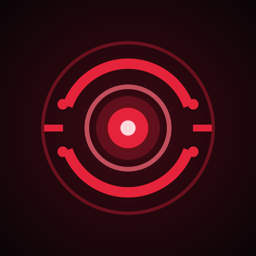

# Crimson

Ücretsiz, reklamsız, sesli yapay zekâ asistanı (Android). / A free, ad-free voice AI assistant for Android.

**Site / Website:** https://crimson-hroc.onrender.com (indirme, SSS, sürümler, SHA-256 ve imza doğrulama)
**İndir / Download:** [Releases](https://github.com/ekipbul-web/Crimson-App/releases/latest)

## Özellikler / Features
- Sesli ve yazılı komut, "Hey Crimson" ile çevrimdışı uyandırma
- Alarm, hatırlatıcı, uygulama açma, hava durumu, haber, web araması, döviz, çeviri
- Fotoğraf, PDF ve ses analizi
- İsteğe bağlı telefon kontrolü (erişilebilirlik hizmeti)
- Home Assistant ile akıllı ev
- Birden fazla sohbet (sabitleme, sohbet başına talimat, tüm sohbetlerde arama, Markdown dışa aktarma)
- Pano asistanı: kopyaladığın metni özetle, çevir, düzelt
- Biçimli yanıtlar, mesaj menüsü (kopyala, paylaş, düzenle)
- Ana ekran widget'ı, simge kısayolları, açık/koyu tema, tema rengi, yazı boyutu, uygulama kilidi, yedekleme, kayıtlı komutlar
- Kendi API anahtarınla çalışır: Google Gemini, OpenAI, Anthropic, Groq, OpenRouter

## Kurulum / Install
Otomatik güncelleme için: [Obtainium'a ekle](obtainium://add/https://github.com/ekipbul-web/Crimson-App)

1. [Releases](https://github.com/ekipbul-web/Crimson-App/releases/latest) sayfasından APK'yı indir ve kur.
2. Uygulama ilk açılışta ücretsiz bir Google Gemini anahtarı almanı adım adım anlatır.

## Gizlilik / Privacy
Sohbetler ve ayarlar yalnızca telefonda kalır, API anahtarları Android Keystore ile şifrelenir. Ayrıntılar: [privacy.html](https://crimson-hroc.onrender.com/privacy.html)

## Geliştirme / Build
APK, `.github/workflows` altındaki iş akışıyla GitHub Actions üzerinde derlenir. `v*` biçiminde bir tag atınca imzalı APK Releases'e eklenir. Gerekli secrets: `KEYSTORE_BASE64`, `KEYSTORE_PASSWORD`, `KEY_ALIAS`, `KEY_PASSWORD`.

## Topluluk / Community
[Telegram](https://t.me/+ExCaZUzHODQxMjZi) · [Instagram](https://www.instagram.com/tuncayskay) · [Destek ol / Support](https://donate.bynogame.com/crimson)

## Lisans / License
MIT, bkz. [LICENSE](LICENSE).
